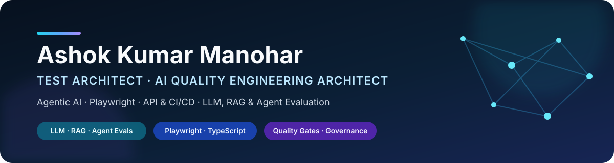

  

<h1 align="center">Ashok Kumar Manohar</h1>
<h3 align="center">Engineering Quality for the AI Era</h3>

<strong>Test Architect | AI Quality Engineer | Forward Deployed AI Engineer | Agentic AI | RAG & LLM Evaluation | MCP | Playwright | API Automation | CI/CD</strong>

  
  
  

## Recruiter snapshot

I architect **enterprise Quality Engineering and AI Assurance systems** spanning traditional automation and production AI. My focus is not only whether a test passed, but whether there is sufficient evidence to prove that an AI system is **reliable, grounded, safe, authorized, observable, governed and ready for release**.

My portfolio connects:

**Data → RAG → Prompt → Model → Agent/MCP → Security → Evaluation → Human Review → Release → Observability → Incident Response → Governance**

> **Evidence first. AI assists engineering decisions; it does not replace engineering controls.**

### Start with the live portfolio

**[Enterprise AI Quality Portfolio & Recruiter Showcase](https://enterprise-ai-quality-portfolio-recruiter-showcase-v700x0.v2.appdeploy.ai/)** — the recruiter front door to a 24-application AI Quality Engineering and Assurance ecosystem.

## Flagship live systems

| System | What it demonstrates | Live demo |
| --- | --- | --- |
| **AI Release Assurance & Governance Control Plane** | Policy-as-code gates, evidence bundles, human approval, rollback contracts and certification | [Open](https://ai-release-assurance-governance-control-plane-8414td.v2.appdeploy.ai/) |
| **Agent Identity, MCP & Tool Governance Studio** | Agent identity, MCP attestation, tool scopes, runtime authorization, approvals and violations | [Open](https://agent-identity-mcp-tool-governance-studio-u3tp1t.v2.appdeploy.ai/) |
| **RAG Evaluation Workbench** | Retrieval traces, Precision/Recall/MRR/NDCG, groundedness, hallucination risk and regression | [Open](https://rag-evaluation-workbench-osc94p.v2.appdeploy.ai/) |
| **AI Observability & Production Monitoring Center** | AI traces, SLOs, drift, release correlation and production reliability | [Open](https://ai-observability-production-monitoring-center-8e6rp3.v2.appdeploy.ai/) |
| **AI Red Team & Safety Evaluation Center** | Adversarial evaluation, safety regression, severity and remediation evidence | [Open](https://ai-red-team-safety-evaluation-center-okdouh.v2.appdeploy.ai/) |
| **FHIR AI Quality Lab** | FHIR validation, SMART scopes, PHI handling, clinical provenance and grounded AI evaluation | [Open](https://fhir-ai-quality-lab-d56846.v2.appdeploy.ai/) |

## One AI Assurance architecture

```mermaid
flowchart LR
    D[Data] --> R[RAG]
    R --> P[Prompt]
    P --> M[Model]
    M --> A[Agent / MCP]
    A --> S[Security]
    S --> E[Evaluation]
    E --> H[Human Review]
    H --> G[Release Gate]
    G --> O[Observability]
    O --> I[Incident Response]
    I --> V[Revalidation / Governance]
```

A production AI transaction should be explainable through an evidence chain such as:

`Source → Chunk → Retrieval → Prompt → Model → Agent → MCP Server → Tool → Authorization → Evaluation → Safety → Human Approval → Release → Production Trace → Incident → RCA → Rollback → Revalidation`

## GitHub engineering proof

| Priority | Repository | Engineering evidence |
| ---: | --- | --- |
| **1** | **[Enterprise AI Quality Engineering Platform](https://github.com/ashokmanohar-ai/enterprise-ai-quality-engineering-platform)** | Unified LLM/RAG/agent/MCP evaluation, datasets, security, observability and hard release gates |
| **2** | **[Playwright Enterprise Test Framework](https://github.com/ashokmanohar-ai/playwright-enterprise-test-framework)** | TypeScript UI/API automation, cross-browser execution, accessibility, CI/CD and evidence-rich quality gates |
| **3** | **[Agentic Quality Engineering Platform](https://github.com/ashokmanohar-ai/agentic-quality-engineering-platform)** | Governed QE agents, explicit state, bounded tools, RBAC, human approval and Playwright execution |
| **4** | **[RAG & LLM Evaluation Lab](https://github.com/ashokmanohar-ai/rag-llm-evaluation-lab)** | Hybrid retrieval, reranking, groundedness, hallucination, citations, latency, tokens and regression evaluation |
| **5** | **[AI Agent Evaluation Framework](https://github.com/ashokmanohar-ai/ai-agent-evaluation-framework)** | Task success, tool use, trajectories, grounding, safety, approvals and recovery evaluation |
| **6** | **[API & Integration Testing Framework](https://github.com/ashokmanohar-ai/api-integration-testing-framework)** | REST, GraphQL, Pact, RBAC, fault injection, events, retries and idempotency |

## What I engineer

| AI Quality & Assurance | Agentic AI | Enterprise QE |
| --- | --- | --- |
| LLM/RAG evaluation | Agent evaluation | Playwright + TypeScript |
| Groundedness & hallucination | MCP governance | API & contract testing |
| Golden datasets | Tool authorization | CI/CD quality gates |
| AI red teaming | Human-in-the-loop controls | Performance & reliability |
| Model/release risk | Runtime traces | Evidence & reporting |
| AI observability | Agent identity & delegation | Test architecture |

## Recruiter 5-minute route

1. **[Portfolio Showcase](https://enterprise-ai-quality-portfolio-recruiter-showcase-v700x0.v2.appdeploy.ai/)** — understand the complete ecosystem.
2. **[RAG Evaluation Workbench](https://rag-evaluation-workbench-osc94p.v2.appdeploy.ai/)** — inspect retrieval and grounding evidence.
3. **[Agent Identity, MCP & Tool Governance](https://agent-identity-mcp-tool-governance-studio-u3tp1t.v2.appdeploy.ai/)** — inspect agent/tool authorization.
4. **[Release Assurance & Governance](https://ai-release-assurance-governance-control-plane-8414td.v2.appdeploy.ai/)** — convert evidence into a release decision.
5. **[AI Observability](https://ai-observability-production-monitoring-center-8e6rp3.v2.appdeploy.ai/)** — follow the system after deployment.
6. **[FHIR AI Quality Lab](https://fhir-ai-quality-lab-d56846.v2.appdeploy.ai/)** — see domain-specific healthcare AI assurance.

The objective is not to show 24 disconnected dashboards. It is to demonstrate **one production AI assurance story**.

## Role alignment

My strongest alignment is with roles involving:

- **AI Quality Engineer / AI Quality Architect**
- **Test Architect / Quality Engineering Architect**
- **Forward Deployed AI Engineer**
- **Agentic AI Quality Engineer**
- **LLM / RAG Evaluation Engineer**
- **AI Assurance / AI Governance Engineering**
- **AI Test Automation Architect**

## Engineering principles

- **Deterministic before probabilistic** — use schemas, contracts and exact evidence wherever possible.
- **Hard gates remain hard** — critical safety, authorization and correctness failures cannot be averaged away.
- **Trace the whole system** — data, retrieval, prompts, models, agents, tools and releases should be attributable.
- **Human accountability** — high-impact actions retain approval and audit evidence.
- **Production feedback becomes regression evidence** — incidents should strengthen future evaluation suites.
- **Transparent portfolio claims** — synthetic/reference demonstrations are kept distinct from measured enterprise delivery outcomes.

## Technical focus

`Agentic AI` · `MCP` · `RAG` · `LLM Evaluation` · `AI Observability` · `AI Governance` · `AI Safety` · `Playwright` · `TypeScript` · `Python` · `API Testing` · `CI/CD` · `Azure OpenAI` · `FHIR` · `Performance Engineering`

## Connect

- **Live portfolio:** [AI Quality Engineering Portfolio](https://enterprise-ai-quality-portfolio-recruiter-showcase-v700x0.v2.appdeploy.ai/)
- **LinkedIn:** [Ashok Kumar Manohar](https://www.linkedin.com/in/ashok-kumar-manohar/)
- **GitHub:** [ashokmanohar-ai](https://github.com/ashokmanohar-ai)
- **Portfolio evidence:** [Verified Evidence Index](https://github.com/ashokmanohar-ai/ashokmanohar-ai/blob/main/PORTFOLIO_EVIDENCE.md)

<strong>Engineering Quality for the AI Era.</strong>

Building quality systems that turn AI behaviour into reviewable engineering evidence.

